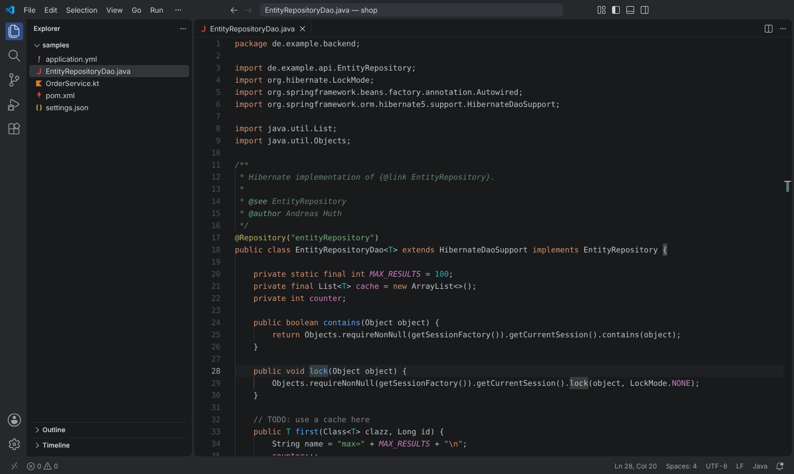
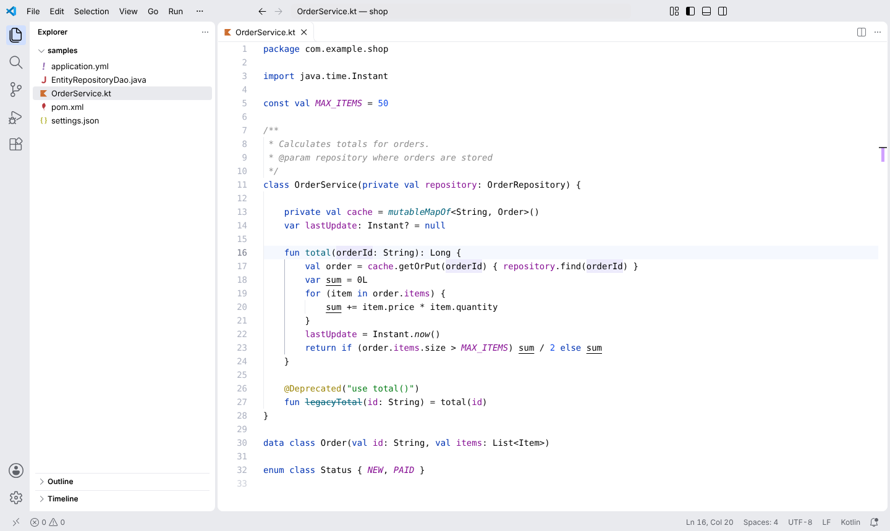
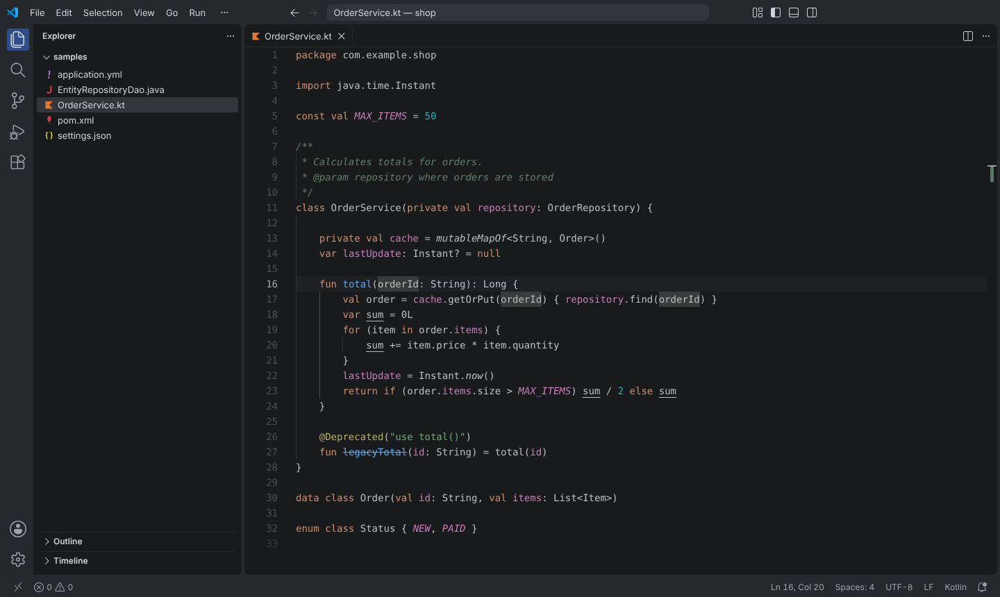
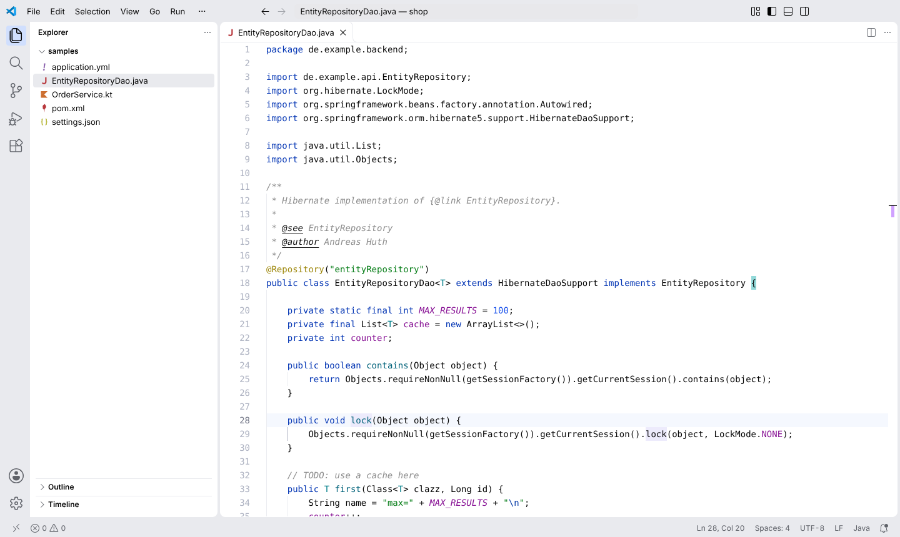

<h1 align="center">
  <br>
  Islands Theme (IntelliJ-inspired)
</h1>

<p align="center">
  <b>Islands Dark</b> and <b>Islands Light</b> for VS Code – the colors of IntelliJ IDEA's Islands themes,<br>
  generated from the JetBrains sources instead of picked by eye.
</p>

<p align="center">
  <a href="https://marketplace.visualstudio.com/items?itemName=andreashuthe.intellij-islands-theme"></a>
  <a href="https://open-vsx.org/extension/andreashuthe/intellij-islands-theme"></a>
  <a href="https://github.com/andreashuthe/intellij-islands-theme/actions/workflows/ci.yml"></a>
</p>





<details>
<summary>More screenshots</summary>




</details>

## Why another JetBrains theme?

Most JetBrains-like themes copy a handful of colors and map them onto TextMate scopes. That's why method
*calls* end up blue and italic, class names get colored and static members look like everything else.

This theme is **generated** from IntelliJ's own files – the *Islands Dark* editor scheme, the *Light* scheme
used by *Islands Light*, the bundled *Darcula*/*Default* parents and the Islands UI themes – and resolves every
color the way IntelliJ does (own value → fallback key → parent scheme). The result:

- **Same syntax colors as IntelliJ**: method declarations blue, calls in the text color, fields purple,
  `static` members italic, annotations yellow, type parameters teal, Javadoc green and italic, …
- **Semantic highlighting for Java and Kotlin**: works with the semantic tokens of
  [Java and Kotlin by IntelliJ IDEA](https://marketplace.visualstudio.com/items?itemName=JetBrains.intellij-server)
  (fields vs. locals, static and `final` fields, type parameters, Kotlin `var`s underlined, deprecated members struck
  through) – and with other language servers that send standard semantic tokens.
- **IntelliJ's UI colors**: the darker/lighter "main window" around the islands (title bar, activity bar,
  status bar), tool windows and editor as islands, IntelliJ's selection, popup, button and focus colors,
  file status (git) colors, diff colors and the console palette for the terminal. With VS Code's modern
  (floating) layout the islands look just like in IntelliJ.
- No bracket pair rainbow (IntelliJ doesn't color brackets either).

## Install

Install **Islands Theme (IntelliJ-inspired)** from the
[VS Code Marketplace](https://marketplace.visualstudio.com/items?itemName=andreashuthe.intellij-islands-theme) or
[Open VSX](https://open-vsx.org/extension/andreashuthe/intellij-islands-theme) (Cursor, VSCodium, Windsurf, …),
then pick **Islands Dark** or **Islands Light** (<kbd>⌘K</kbd> <kbd>⌘T</kbd> / <kbd>Ctrl+K</kbd> <kbd>Ctrl+T</kbd>).

Follow the OS appearance like IntelliJ's *Sync with OS*:

```jsonc
"window.autoDetectColorScheme": true,
"workbench.preferredDarkColorTheme": "Islands Dark",
"workbench.preferredLightColorTheme": "Islands Light"
```

### Recommended settings for the full IntelliJ look

A theme can't change fonts or layout – these settings get you the rest of the way:

```jsonc
"editor.fontFamily": "JetBrains Mono",          // IntelliJ's default editor font (free, jetbrains.com/lp/mono)
"editor.fontSize": 13,
"editor.lineHeight": 1.4,
"editor.fontLigatures": false,
"editor.semanticHighlighting.enabled": true,     // default "configuredByTheme" works too
"editor.bracketPairColorization.enabled": false,  // not needed – the theme already uses one color
"editor.renderLineHighlight": "line",
"editor.guides.bracketPairs": false,
"workbench.tree.indent": 12
```

Together with [IntelliJ Java/Kotlin Navigation](https://marketplace.visualstudio.com/items?itemName=andreashuthe.intellij-java-kotlin-navigation)
("7 usages", "1 implementation", "↑ Interface" hints) VS Code feels quite a bit like home.

## Good to know

- **Java without the JetBrains language server**: VS Code's Java grammar can't tell fields from locals or static
  calls from instance calls. The theme handles the common cases (field declarations and `obj.field` access are
  purple, calls use the text color); everything else needs semantic tokens from a language server.
- **Static method calls in Java** are italic in IntelliJ. The JetBrains language server currently doesn't send
  semantic tokens for Java *methods*, so they stay upright in VS Code.
- **Rounded islands with gaps** need VS Code's modern UI (default in recent versions). Older versions show the same
  colors with straight borders.

## Development

```bash
npm install
npm test               # regenerates themes/*.json from jetbrains/ and checks colors against IntelliJ
npm run test:vscode    # once: downloads VS Code (its Java grammar is used by the color tests)
npm run screenshots    # docs/*.png via Playwright (npm i --no-save playwright), Linux: xvfb-run -a …
npx vsce package       # .vsix
```

`themes/*.json` are **generated** – change `scripts/build.js` (scope / semantic token / UI mappings) instead.
The IntelliJ sources are in [`jetbrains/`](jetbrains/README.md). Press <kbd>F5</kbd> in VS Code to try the theme
in an Extension Development Host. Releases: see [RELEASING.md](RELEASING.md).

## License

[Apache License 2.0](LICENSE). The colors come from IntelliJ IDEA Community Edition, © JetBrains s.r.o.,
Apache License 2.0 – see [NOTICE](NOTICE).
IntelliJ IDEA and JetBrains are trademarks of JetBrains s.r.o.; this project is not affiliated with or endorsed by
JetBrains.
